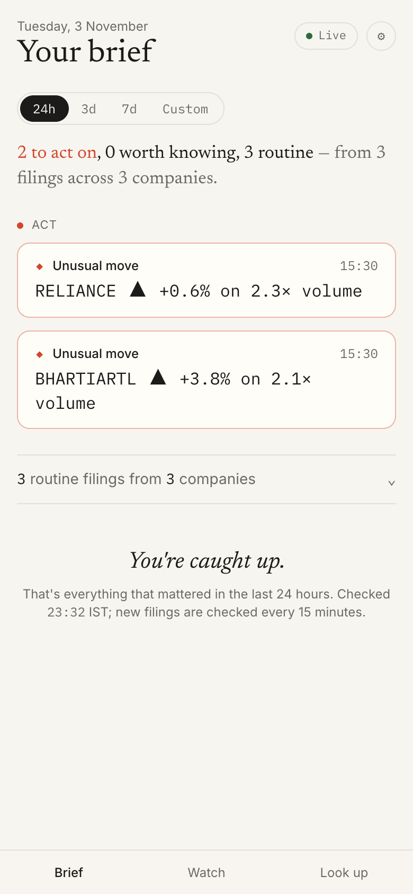
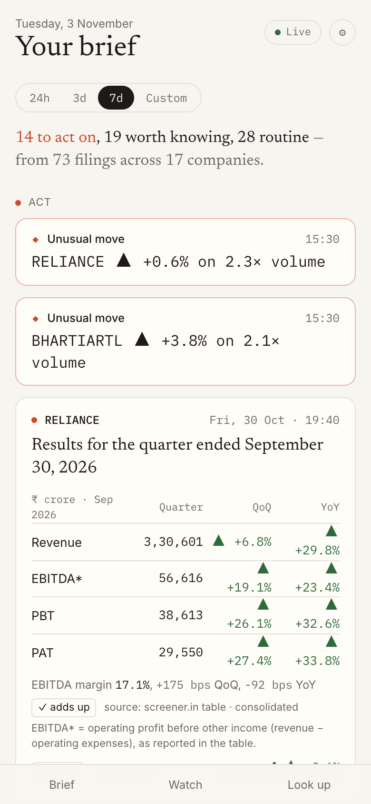
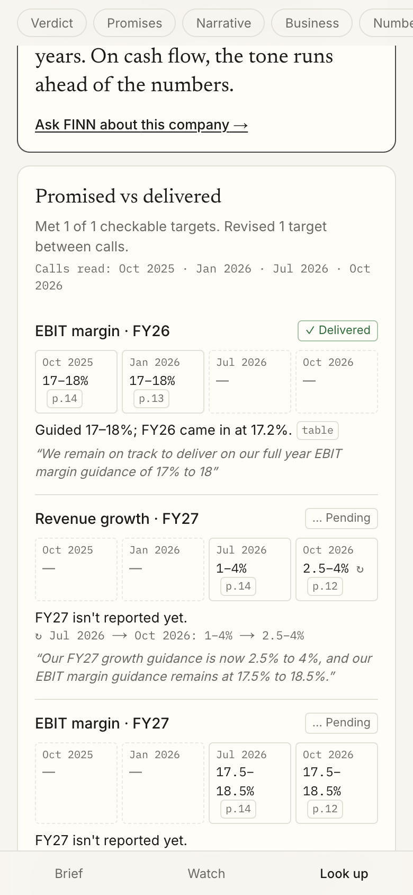
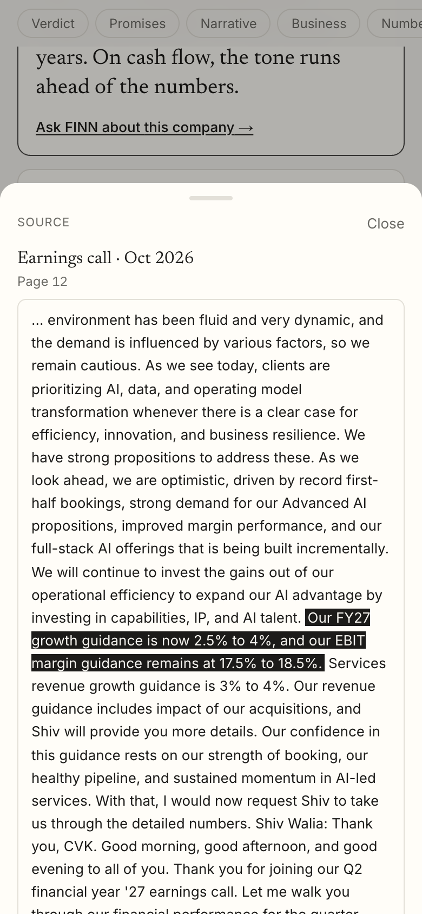
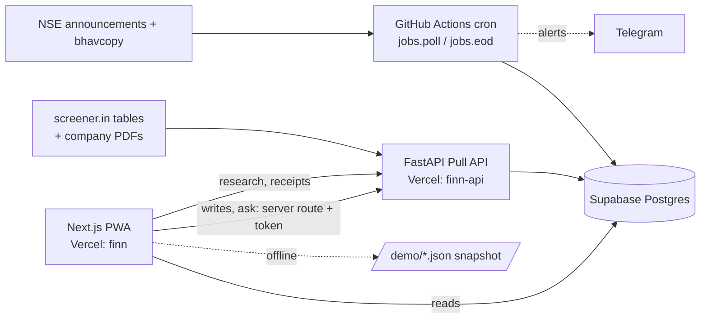

# FINN — Financial Investment Agent

An editor, not a terminal. FINN reads every exchange filing from your portfolio and gives you a finite brief, ranked
into **Act**, **Know** and **Routine**, with the reason each item is there. Look up any NSE company to see what
management promised on its calls against what it delivered. Tap any number or claim to see its source page.

**Open it on a phone:** https://finn-beryl-delta.vercel.app. It's a PWA, so you can add it to your home screen.


| Brief | Results card | Promise ledger | Receipt |
|---|---|---|---|
|  |  |  |  |

## What it does

**Push (the Brief).** An NSE filings poll runs every 15 minutes, and end-of-day prices come in at 17:30 IST.
- **Ranking.** Every filing is classified (rules first, a model only for leftovers) and scored by a transparent
  weight table, then ranked into Act, Know or Routine with its reasons.
- **Results cards.** These show Revenue, EBITDA, PBT and PAT with QoQ and YoY changes. The numbers are checked by
  the table's own arithmetic, and the card says "unverified" when they don't add up.
- **Management-change cards.** These show who is in and who is out.
- **Alerts.** Price and volume alerts fire on thresholds you set as editable sentences. Each alert names the likely
  cause.
- **Triage.** Swipe to mark Noted or Snooze, with Undo. After three Noted swipes on one kind of filing, FINN offers
  to treat that kind as routine.
- **Watch.** This screen ranks your holdings by what needs attention.

**Pull (Look up).** Works for any NSE ticker. Number cards appear in about 4 seconds; then FINN reads the last 4
earnings-call transcripts and the annual report and builds:
- **Verdict:** one line.
- **Promised vs delivered:** each guidance thread across the calls, with a deterministic verdict against the reported
  tables, and target revisions marked.
- **Narrative vs numbers:** what management said about margins, growth, cash, debt and working capital, set against
  the trend in the tables.
- **Guidance, Bull vs bear and Business snapshot.**
- **Lighthouse mobile Performance:** Brief 98, Watch 96, research page 94.
- **Receipts:** every number opens its table row. Every quote opens its transcript page, with the sentence highlighted.
- **Ask FINN:** answers only from the company's own documents. When they don't cover a question, it says so.

**Rules FINN keeps.**
- No number is ever written by a model.
- Pull reads primary sources only: no news, no web search. A test fails the build if `pull/` imports a search client.
- A source failure degrades one card, never the page.
- If live services are down, the app falls back to a frozen snapshot and says so.

### Model keys are optional
Every card has a rule path, so FINN runs with no model keys at all. That is how it is deployed today, at **₹0**
(see [docs/cost.md](docs/cost.md)). Each key adds one capability, with no code change:

| Key | Adds |
|---|---|
| `GEMINI_API_KEY` | Classifier fallback (P1), results-PDF cross-check (P2), model-read guidance and claims (P7, P8), business snapshot (P6), verdict wording (P12), written Ask answers (P13) |
| `ANTHROPIC_API_KEY` | Written ledger notes and pattern (P9), narrative analysis (P10), bull and bear cases (P11) |
| `TAVILY_API_KEY` | A sourced background of an incoming CFO or CEO (Push only; Pull never searches the web) |
| `TELEGRAM_BOT_TOKEN` | Alerts pushed to your phone. Send the bot a message first so it knows where to post |

Add these to `.env`, to GitHub Actions secrets (for Push) and to the `finn-api` Vercel project (for Pull). All
model text passes a number check that strips any figure not present in the inputs ([numcheck.py](backend/finn/pull/numcheck.py)).

## Architecture



- `backend/finn/push/` holds Push: classify, score, digest, results, mgmt, oneliner, alerts, notify, pipeline.
- `backend/finn/pull/` holds Pull:
  - Number cards: `numbers.py`.
  - Documents: `bundle.py` and `chunks.py`.
  - Guidance and claims: `guidance.py` and `claims.py`.
  - Analysis: `ledger.py`, `narrative.py`, `snapshot.py` and `bullbear.py`.
  - Ask FINN: `ask.py`.
  - The job that runs them in order: `run.py`.
- `backend/finn_api/main.py` is the API. `backend/jobs/` holds the cron and maintenance jobs.
- `web/` is the PWA. `web/lib/digest.ts` mirrors `push/digest.py`, and one fixture pins both.

## Run it locally

```bash
cp .env.example .env          # fill in SUPABASE_DB_URL and NEXT_PUBLIC_SUPABASE_*; everything else is optional
psql "$SUPABASE_DB_URL" -f supabase/schema.sql -f supabase/seed_companies.sql
python3.12 -m venv .venv && .venv/bin/pip install -r backend/requirements.txt
cd backend && ../.venv/bin/python -m jobs.poll --since 7d && ../.venv/bin/python -m jobs.eod
../.venv/bin/uvicorn finn_api.main:app --port 8008          # Pull API
cd ../web && npm i && NEXT_PUBLIC_API_URL=http://localhost:8008 npm run dev
```

Tests: `cd backend && ../.venv/bin/python -m pytest -q` (70 tests) and `cd web && npm test`. CI runs both, plus
`npm run build`, on every push ([test.yml](.github/workflows/test.yml)).

## Deploy

- **Web:** run `vercel deploy --prod` from `web/`. Env: `NEXT_PUBLIC_SUPABASE_URL`,
  `NEXT_PUBLIC_SUPABASE_PUBLISHABLE_KEY`, `NEXT_PUBLIC_API_URL`, and the server-only `FINN_API_TOKEN`.
- **API:** run `vercel deploy --prod` from `backend/`. The entrypoint `finn_api.main:app` is set in `pyproject.toml`.
  Env: `SUPABASE_DB_URL`, `FINN_API_TOKEN`, `FINN_WEB_ORIGINS`, plus any model keys.
- **Push:** GitHub Actions ([push.yml](.github/workflows/push.yml)) with the secret `SUPABASE_DB_URL`.
  [keepalive.yml](.github/workflows/keepalive.yml) stops Supabase from pausing.
- **Demo snapshot:** `python -m jobs.warm --research --freeze` refreshes `web/public/demo/`.

## Known limitations

- **No BSE feed.** BSE's API refuses automated clients, so filings come from NSE only ([docs/sources.md](docs/sources.md)).
- **No XBRL results.** NSE's XBRL results index stops in January 2025. Results come from screener's table and are
  checked by arithmetic; with a Gemini key, the filing PDF is cross-checked too.
- **Rule-based reading is narrower than the model path.**
  - It finds guidance that management states as numbers: revenue growth, EBITDA or EBIT margin, PAT growth,
    order inflow, capex and US$ revenue goals.
  - It skips segment-level targets.
  - Some companies yield only 2–3 guidance threads.
  - Quotes are verbatim, so every verdict can be checked.
- **The business snapshot needs a model key.** Without one, the card says so.
- **Guidance in constant currency** (IT services) is checked against INR revenue growth.
- **No OCR.** Scanned PDFs are flagged rather than read.
- **Single-user demo auth.** Writes are protected by one shared token held server-side.
- **Not built:** native app and push, voice, intraday data, multi-user accounts, valuation and price targets.

More detail: [PLAN.md](PLAN.md) (phases, deltas, status), [docs/writeup.md](docs/writeup.md),
[docs/generalise.md](docs/generalise.md) (30 unseen tickers), [docs/cost.md](docs/cost.md),
[docs/build-history/](docs/build-history/).
